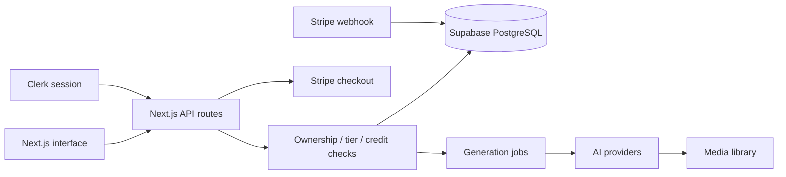

# Architecture

The diagram describes code boundaries, not a claim that every path is verified in production. Clerk subjects are mapped to application user records. User-scoped database clients use Clerk session tokens; privileged server clients also exist and require explicit ownership checks at each route boundary. Service-role keys must remain server-only.

The image-visibility route checks ownership before updating. A regression test asserts that another user's image is rejected before the database update. Checkout authentication now occurs before Stripe initialization, allowing unauthenticated rejection without configured payment credentials. Contract tests cover validation and model-tier decisions without making paid calls.

Generation jobs and credit accounting span external services. Failure/retry behavior, webhook replay handling, and concurrent credit deductions need end-to-end integration tests before making exactly-once or payment-correctness claims. The in-memory rate limiter is a single-process control, not a distributed quota system.
